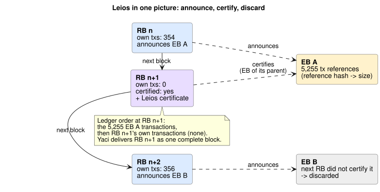

# Leios complete blocks: design

How `BlockSync` and `BlockRangeSync` turn a block that certifies an endorser block (EB) into one complete block.
Decision record: [ADR 0016](../../adr/0016-leios-on-next-ccl-parsing-and-era-activation.md) (D3 to D5). It supersedes
[ADR 0013a](../../adr/0013a-leios-complete-blocks.md) wherever they disagree; this page summarises the code at HEAD
and does not repeat the ADR's rules.

## 0. Leios in one picture

- RB n+1 certifies the EB announced by its **parent** RB n (found through `prevHash`).
- What the application sees for RB n+1: one block, with EB A's transactions first.

## 1. Where it lives

| Part | Class (helper module) | Job |
| :--- | :--- | :--- |
| Configuration | `LeiosConfig` | `inlineEndorserBlockTxs`, `skipUnavailableEndorserBlocks`; passed to `BlockSync` / `BlockRangeSync` only |
| Start ownership | `SyncControl` | One start = one main client + one assembler + one resolver. Selects, retires and halts starts; wraps the listener only when `inlineEndorserBlockTxs` is true |
| Assembler | `CompleteBlockAssembler` | The listener delegate of one start. Forwards every callback at once, on the calling thread; completes certifying blocks inside `onBlock` |
| Announcement cache | `EbAnnouncementCache` | The last 4,096 `ebAnnouncement`s and slots by block hash; one per `BlockSync` / `BlockRangeSync`, kept across restarts and halts |
| EB resolver | `EndorserBlockResolver` | The LeiosFetch side connection: fetch the EB and its transactions, check them, map them |
| Parent lookup | `ParentBlockLookup` | A short-lived ChainSync + BlockFetch connection that fetches an unseen parent privately, searching windows of 1,000 slots |
| Merge | `BlockSerializer.withEndorserBlockTxs` (core) | Maps the EB transactions with the block's own mappers and merges them |
| Transaction list | `TransactionListBuilder` | Rebuilds the `onBlock` transaction list from the merged block |

## 2. One certifying block, step by step

1. `onBlock` arrives on the main connection's event loop with `leiosCertInBody == true`. Any other block is forwarded
   unchanged.
2. The parent's announcement comes from the cache by `prevHash`, or from `ParentBlockLookup`.
3. The resolver opens (or reuses) its side connection: handshake with `N2NVersionTableConstant.v11AndAbove(magic)`,
   accepted only for an offered version, V15 or later, not app-layer, with the main connection's magic. It carries
   `LeiosFetchAgent` only. It is replaced when older than 45 s or idle for 30 s; the handshake wait is capped at 10 s.
4. It requests the EB and then all its transactions. CCL reads the EB references (`RawEbReferences`). The
   references must hash to the announced hash and have the announced size; each transaction must match its entry's
   hash and size.
5. `BlockSerializer.withEndorserBlockTxs` slices each transaction `[body, witnesses, aux / null, is_valid]` with CCL
   `CborSpan`, maps it with the block's own mappers, and builds the block with `toBuilder()`: EB transactions first,
   aux data and invalid indexes shifted, `leiosEndorserBlock` set. Header, certificates and `Block.cbor` are kept as
   received.
6. The assembler forwards the complete block to the application's `onBlock`, on the same thread.

All of this runs within one **45 s budget** per call: attempts follow each other after a 1 s pause, each with the
time left as its deadline. Each failed attempt is reported through `onEndorserBlockUnavailable`.

## 3. When the budget runs out

| `skipUnavailableEndorserBlocks` | Result |
| :--- | :--- |
| `false` (default) | `SYNC_HALTED`: the block is not forwarded, the start's delegate drops every later callback, a separate thread stops the main client, `isRunning()` is false. Yaci logs the block and EB at ERROR. The application restarts from its own cursor. |
| `true` | `DELIVERED_WITHOUT_EB_TXS`: the block is forwarded as received, with its own transaction list. |

Stopping or replacing a start (`stop`, `startSync`, `startSyncFromTip`, `start`, `restart`) cancels a certifying
call in progress; that call returns without delivering, and the start's later callbacks are dropped. Without a call
in progress, a plain `stop()` keeps forwarding the stopped start's callbacks as on `next`, while a start replaced by a
newer one forwards nothing but its disconnects (`onDisconnect`, as on `next`). The full ownership rules are ADR 0016 D3c.

## 4. What does not change

- The main connection: same version table, agents and mux decoding as on `next`. No Leios agents on it.
- Every block without `leiosCertInBody == true`: same objects, same thread, same error path.
- `inlineEndorserBlockTxs = false`: no assembler and no side connection; certifying blocks arrive as received.
- `N2NChainSyncFetcher`, `BlockFetcher`, `BlockStreamer` and `PeerClient` deliver blocks as received.
- Over node-to-client, the node inlines the EB's transactions itself.

## 5. Rollbacks and duplicates

EB transactions belong to the certifying block, so they roll back with it; no new rollback handling is needed.
Announcements are keyed by block hash, so a block from an abandoned fork never matches. Delivery stays at least
once, as on `next`.
