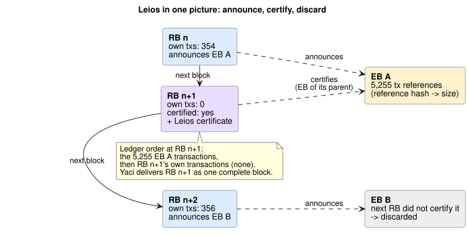
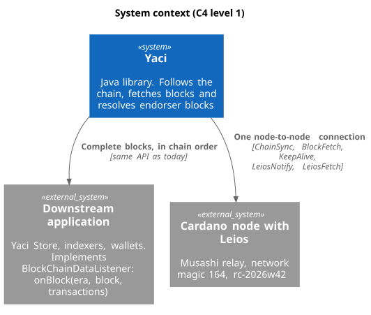
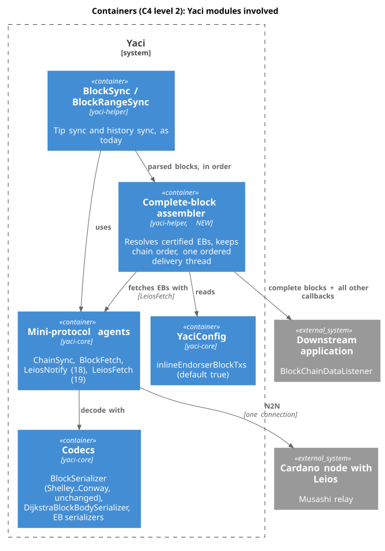
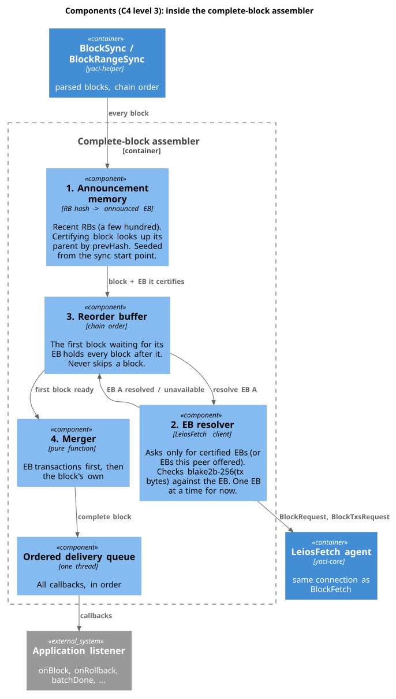
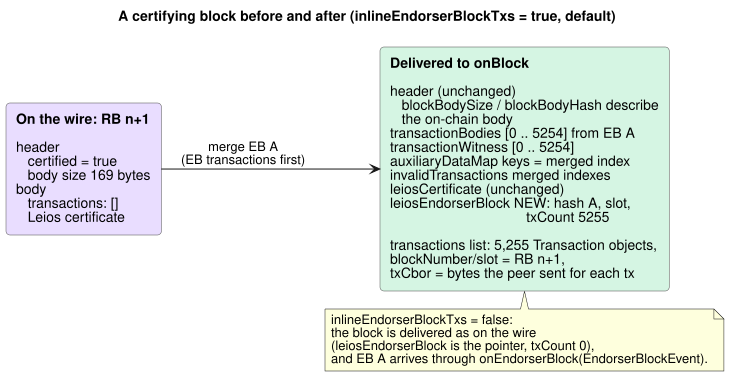
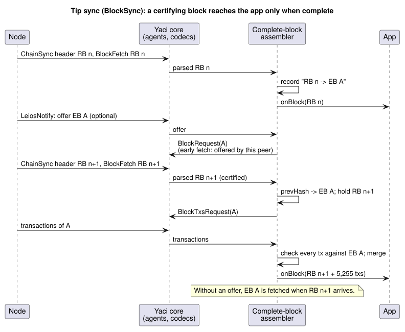
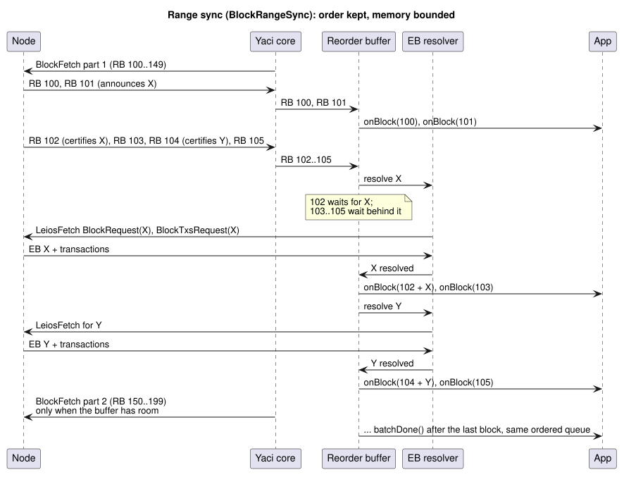

# Leios complete blocks: design

How Yaci turns Linear Leios blocks into complete blocks for applications, without changing Yaci's API.
Decision record: `adr/0013-leios-complete-blocks.md`.

The diagrams follow the C4 model, from the outside in. Images are generated from the PlantUML sources in
`diagrams/` (see `diagrams/README.md`); PNG copies sit next to each SVG.

1. System context: who talks to whom.
2. Containers: the Yaci modules involved.
3. Components: the parts of the new complete-block assembler.
4. Dynamic views: what happens, step by step, for tip sync, range sync, failures and rollbacks.

---

## 0. Leios in one picture

- RB n+1 certifies the EB announced by its **parent** RB n (found through `prevHash`).
- Certification happens at least 14 slots after the announcement on Musashi's parameters
  (CIP-0164: 3 × header diffusion + vote period + diffusion period = 3 × 1 + 4 + 7 slots).

What an application must see for RB n+1: one block with the 5,255 EB A transactions. That is the default.

---

## 1. System context (C4 level 1)

---

## 2. Containers (C4 level 2): Yaci modules involved

The assembler and its Leios connection exist only when `LeiosConfig.shouldInlineEndorserBlockTxs(magic)` is
true: inlining on and Leios active (`AUTO`: Musashi magic 164). On mainnet and preprod `BlockSync` and
`BlockRangeSync` keep using the application's own listener object, and no second connection is opened.
The main connection is unchanged in every case.

---

## 3. Components (C4 level 3): inside the complete-block assembler

| Part | Holds | Rule |
|---|---|---|
| Announcement memory | the last 4,096 announcements, by RB hash | look up by the certifying block's `prevHash`; if the parent was never seen, fetch it once (ChainSync `FindIntersect` for that hash over the 1,000 slots before the child, then BlockFetch; or the sync start point directly) |
| EB resolver | requests in flight, by EB point | ask only for **certified** EBs; check the EB's hash; fetch all its transactions in one request; check `blake2b-256(tx bytes as received) == EB reference hash` for every one |
| Ordered queue | up to 256 callbacks | deliver strictly in arrival order on one thread; a certifying block waits for its EB and holds every event behind it; a full queue makes the main connection's thread wait |
| Merger | nothing | certifying block + EB transactions → complete block |

---

## 4. The complete block (`inlineEndorserBlockTxs = true`, default)

What changes in a certifying block (RB n+1 in the picture above) before it reaches the application:

With `inlineEndorserBlockTxs = false`, nothing is wrapped: the block is delivered exactly as today (left side;
`leiosEndorserBlock` is null). The certified EB is the one announced in the parent block's header, and EB data
arrives through the optional `onEndorserBlock(EndorserBlockEvent)` callback.

Every block that certifies nothing is delivered exactly as before.

---

## 5. Dynamic view: tip sync (BlockSync)

The EB fetch starts as soon as the certifying block arrives; it does not wait for the peer to offer anything.
On the live network a 5,255-transaction EB takes about one second. The application receives RB n+1 only once it
is complete.

---

## 6. Dynamic view: range sync (BlockRangeSync)

- Memory stays bounded: at most 256 queued callbacks. When the queue is full, the main connection's thread
  waits, so Yaci reads blocks more slowly, the same back-pressure a busy listener gives today. EB answers keep
  arriving on the separate Leios connection. `stop()`, `restart()` and `startSync()` close the assembler before
  the connection, which releases a network thread waiting for queue space, so stopping cannot deadlock either.
- Yaci Store's batch of 100 blocks receives complete blocks in order, and `batchDone` arrives after the last
  block of the range, through the same ordered queue. Its parallel pipeline is unchanged.

---

## 7. Failures, retries and rollbacks

| EB resolver result | `skipUnavailableEndorserBlocks = false` (default) | `= true` (opt-in) |
|---|---|---|
| resolved, every transaction checks | merge and release | merge and release |
| not found, timeout or a transaction that does not match | report `onEndorserBlockUnavailable`, retry with a growing delay; delivery waits (a visible pause, no gap) | report `onEndorserBlockUnavailable`, release the block without the EB transactions |
| peer has no Leios protocols | reported through `onEndorserBlockUnavailable` with that reason; retried | reported; released without EB transactions |

A transaction that does not match the EB is never delivered: it is treated like "not found".

Rollback: the node rolls back ranking blocks. EB transactions belong to the certifying block, so they roll back
with it. A certifying block still waiting when a rollback arrives behind it stops waiting and is delivered as on
the wire (as today), followed by `onRollback` through the ordered queue. Announcements are keyed by block hash, so
blocks from an abandoned fork never match. Nothing new is needed in the application.

---

## 8. What is pinned to which network version

| Piece | Deployed Musashi (`prototype-2026w40a`) | Next respin (`rc-2026w42`) |
|---|---|---|
| RB body | `[txs, leios_cert, peras_cert]`, tx = `[body, wits, aux, is_valid]` | same |
| LeiosFetch tags | BlockRequest 0, Block 1, TxsRequest 2, BlockTxs 3 | renumbered: 1, 2, 3, 4 |
| EB transactions | `[point, bitmaps, [* bytes]]`, mempool encoding | `[* #6.24(block_transaction)]` |
| Old certified EBs served | yes (tested 4 weeks back, first 8 txs) | untested |
| Request the node cannot answer | empty answer | connection is closed |

The application-facing behaviour is the same for both. Only the codecs change; they are tracked in
`adr/leios-todo.md`.
